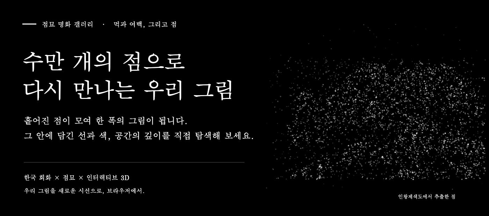
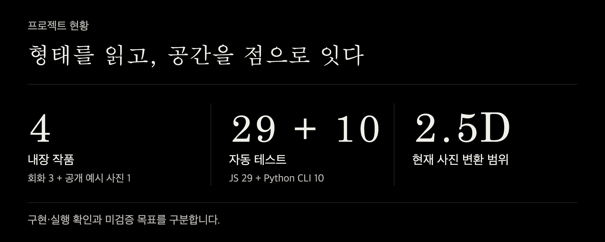
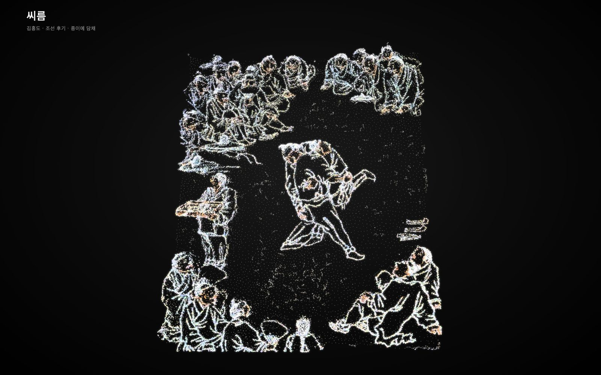
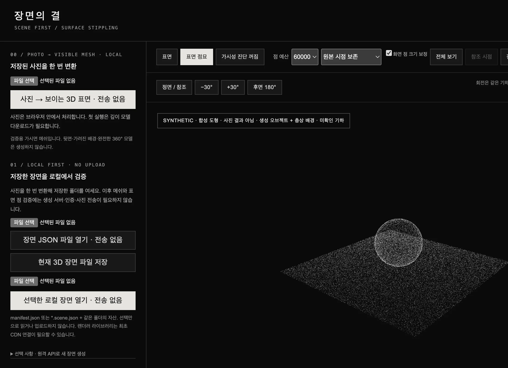
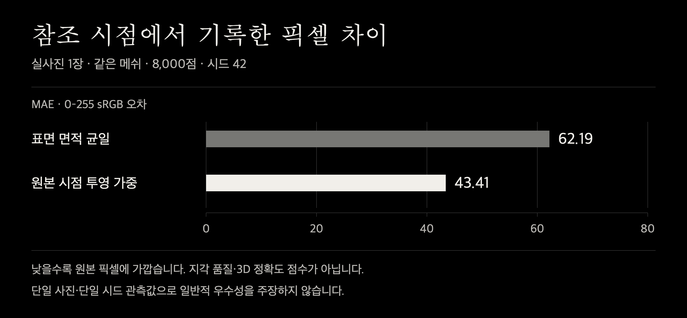
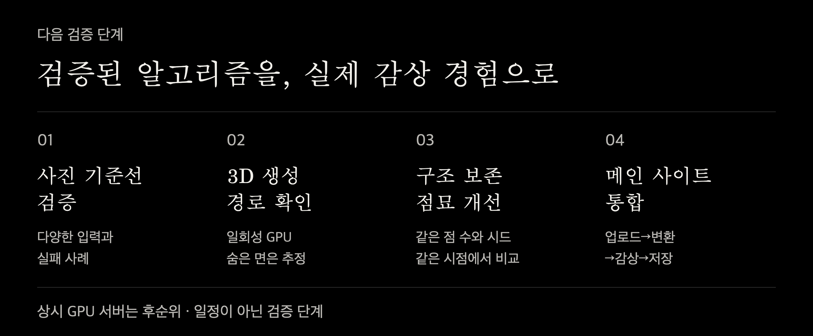
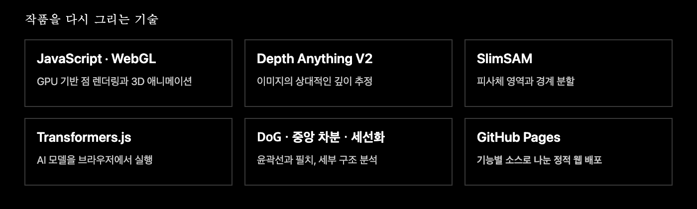

<div align="center">

<a href="https://devjwk.github.io/pointillism-gallery/"></a>

**그림의 구조를 읽고, 점으로 공간을 탐색하는 인터랙티브 아트 프로젝트**

[PC 갤러리](https://devjwk.github.io/pointillism-gallery/?view=pc) · [모바일 갤러리](https://devjwk.github.io/pointillism-gallery/?view=mobile) · **[장면의 결 · 검증 도구](https://devjwk.github.io/pointillism-gallery/tools/scene-validation/)**

[프로젝트 목표](#프로젝트-목표) · [현재 진행 상황](#현재-진행-상황) · [실제 결과](#실제-결과) · [앞으로의 계획](#앞으로의-계획) · [코드 구조](#코드-구조) · [실행과 검증](#실행과-검증)

</div>

<br>

## 프로젝트 목표

> **사진이나 명화를 올리면, 그 구조를 살린 점묘 3D로 변환하고 직접 탐색할 수 있는 사이트.**

단순히 점을 많이 찍거나 사진에 깊이 효과를 붙이는 데서 멈추지 않습니다. 피사체와 배경을 구분하고, 적은 점으로도 중요한 형태와 디테일을 보존하며, 회전·확대·선택을 통해 그림을 새롭게 감상하는 경험을 지향합니다.

- **구조:** 피사체와 배경이 섞이지 않도록 구분하고, 윤곽·얼굴·선·색을 살리는 점 배치.
- **공간:** 실제 메쉬 표면에 점을 배치하고, 향후 뒷면과 가려진 배경의 생성 가설까지 구분해 탐색.
- **이해:** 구성요소와 맥락을 살펴보는 감상 경험. 업로드 사진의 자동 의미·맥락 생성은 아직 미구현.
- **사용성:** 사진에 맞는 설정과 `사진 선택 → 변환 → 감상 → 저장` 흐름을 웹사이트에 연결.

**최종 목표와 현재 구현은 다릅니다.** 현재 사진 변환은 보이는 면의 **2.5D 기준선**이며, 완전한 3D 생성과 메인 사이트 자동 통합은 아직 완료하지 않았습니다.

<br>

## 현재 진행 상황



- **공개 배포 · 메인 갤러리**<br>
  회화 3점·기존 공개 예시 사진 1점. WebGL 점 렌더링, 작품 전환, 상하좌우 360° 회전·확대, 점 밀집도, RGB·색 보정, PC·모바일용 설정을 제공합니다. 선·디테일 분석, SlimSAM 분할과 피사체 선택도 구현했습니다. 내장 작품의 의미 이름·맥락은 수동 정의이며 업로드 사진의 자동 의미 인식은 아닙니다.
- **실행 확인 · 가시면 메쉬와 표면 점묘**<br>
  브라우저 로컬 상대 깊이 추정과 삼각형 표면 생성으로 실사진 기술 파일럿 1건을 기록했습니다. 고정 시드·정확한 총 점 예산, 회전 시 점 유지와 저장 파일 재로딩을 확인했습니다. 다수 사진의 지각 품질은 별도 검증이 필요합니다.
- **분리 완료 · 기능별 코드**<br>
  갤러리 22개 기능별 소스, 독립 검증 도구, 일회성 GPU 경로, 문서·테스트·개발 스크립트로 구분했습니다.
- **코드 준비 · 뒷면과 가려진 배경 생성**<br>
  SAM3D·SAM2·LaMa 연결 프로토타입입니다. 실제 GPU 추론, 모델 환경과 생성 품질은 미검증입니다.
- **미완료 · 메인 사이트 자동 통합**<br>
  검증된 변환·점 배치 기능부터 연결할 예정입니다. 사진별 자동 맞춤, 업로드 사진의 자동 의미·맥락 생성과 전체 3D 생성 흐름은 아직 완료하지 않았습니다.

메인 갤러리는 **감상 공간**, [장면의 결](tools/scene-validation/README.md)은 **알고리즘을 확인하는 작업대**입니다. 검증 도구가 추가됐다고 새 변환 알고리즘이 메인 갤러리에 자동 적용된 것은 아닙니다.

<br>

## 실제 결과

### 1. 현재 갤러리의 표현

기존에 공개된 뷰어 화면입니다. 아래 이미지는 **깊이와 점으로 표현한 감상 예시**이며, 실측 3D 복원 정확도를 보여주는 자료는 아닙니다.

<table>
  <tr>
    <td align="center" width="50%"><br><b>인왕제색도</b><br><sub>정선 · 먹의 농담과 앞뒤 층</sub></td>
    <td align="center" width="50%"><br><b>씨름</b><br><sub>김홍도 · 인물과 배경의 깊이</sub></td>
  </tr>
  <tr>
    <td align="center" width="50%"><br><b>미인도 · 선 분석</b><br><sub>신윤복 · 색과 윤곽, 옷의 주름</sub></td>
    <td align="center" width="50%"><br><b>장면의 결 · 합성 검사</b><br><sub>구와 평면으로 확인한 렌더러. 실사진 생성 결과 아님</sub></td>
  </tr>
</table>

<details>
<summary>전체 PC 화면과 모바일 UI 보기</summary>


모바일용 레이아웃·터치 조작은 구현되어 있지만, 실기기별 성능 검증이 완료됐다는 뜻은 아닙니다.

</details>

### 2. 실사진 1장으로 기록한 가시면 기술 파일럿

**2026-10-21 기록 · 입력 1장 · 샘플링 시드 42 · 상대 깊이 기반 · GPU 장면 생성 미실행**

| 항목 | 실제 기록 |
|---|---|
| 정점 | **49,152개** |
| 삼각형 | **96,277개** · 경계에서 제외한 1,133개는 미포함 |
| 점 수 | **4,000 / 8,000 / 16,000개** · 각 예산과 실제 수 일치 |
| 회전 | **+30° / −30° / 180°**에서 같은 점 버퍼 유지 |
| 재로딩 | 저장 파일을 다시 열어 **동일 점 지문 확인** |
| 업로드 | 해당 로컬 변환 버튼 검사에서 **요청 0건 관측** |

180° 보기는 복원된 뒷면이 아닙니다. 최초 라이브러리·모델 다운로드는 필요하며, 0건 관측은 모든 실행 환경의 네트워크 감사 인증을 뜻하지 않습니다.

개인 사진의 원본·변환 이미지·장면 파일·식별 정보는 공개하지 않고 **수치만 익명화**했습니다. 따라서 이 사진에 대한 수치를 제3자가 동일 입력으로 재현할 수 있는 공개 데이터셋은 제공하지 않습니다.



같은 메쉬·8,000점·시드 42에서, 원본 시점 투영 가중 방식의 픽셀 차이가 면적 균일 방식보다 작게 기록됐습니다. **단일 사진·단일 시드 관측값으로, 알고리즘의 일반적 우수성이나 3D 정확도를 입증하지 않습니다.**

<details>
<summary>점 예산별 실제 수치와 측정 조건</summary>

참조 시점의 같은 영역을 **192×256 sRGB**로 비교했습니다. MAE는 채널별 평균 절대 차이, RMSE는 평균 제곱 차이의 제곱근입니다. 범위는 채널값 기준 0~255이며, 낮을수록 해당 원본 픽셀에 가깝습니다.

면적 = 표면 면적 균일, 참조 = 원본 시점 투영 가중. 지름은 CSS px입니다.

| 방식 | 점 수 | 지름 | MAE | RMSE |
|---|---:|---:|---:|---:|
| 면적 | 8,000 | 7.02 | 62.19 | 93.06 |
| 참조 | 4,000 | 9.93 | 45.10 | 74.72 |
| 참조 | 8,000 | 7.02 | 43.41 | 72.54 |
| 참조 | 16,000 | 4.96 | 42.62 | 71.24 |

연속 메쉬 표면 참고값은 **MAE 11.39 / RMSE 24.35**입니다.

- 점 수가 바뀌면 화면 점 크기 보정도 함께 바뀝니다. 따라서 예산별 차이를 **점 수 하나만의 효과**로 해석할 수 없습니다.
- 픽셀 차이는 점의 크기·빈틈·배경·렌더링 방식에도 영향을 받습니다. 지각 품질 점수, 피사체 인식률, 실측 깊이 오차가 아닙니다.
- 연속 표면과 이산 점묘는 표현 방식이 다르므로, 메쉬 참고값으로 점묘 알고리즘의 우열을 판정하지 않습니다.
- 카메라 FOV와 깊이 스케일은 가정값입니다. 카메라 구성의 산술적 재투영 일관성도 실제 형상 정확도의 증거는 아닙니다.

[익명화한 원시 집계값](docs/results/visible-surface-pilot.json) · [측정 방법·공개 범위](docs/results/README.md)

</details>

### 3. 코드와 실행 흐름 검증

**후속 변경 · 점 밀집도:** 점 수와 별개로 원래 형태 주변의 흩어짐을 조절합니다. 100%는 기존 배치, 낮은 값은 같은 점의 국소 분산입니다. 밀집도 회귀 검사 8개를 추가해 현재 JavaScript **43개가 통과**했습니다. [사용·검증 안내](docs/density.md)

**360° 자유 회전:** 기본 회전 상한을 없애고 드래그·방향키·관성에 적용했습니다. 회전 변경 당시 JS 35개가 통과했으며 제한 모드는 선택해서 사용할 수 있습니다. [변경·검증 안내](docs/rotation.md)

아래 29개·10개 수치와 위 현황 이미지는 이전 문서화 시점의 스냅샷입니다.

- **JavaScript 29개 통과:** 갤러리 소스·DOM 연결, 삼각형 샘플링, 가시면 기하, 로컬 파일 안전성, 시드·점 예산, GitHub Pages 하위 경로.
- **Python CLI 10개 통과:** 인자와 범위, 독립 시드, 덮어쓰기 거부, 실패 시 정직한 상태 기록 등 표준 라이브러리 검사.
- **분리 전후 실행 코드 일치:** 기존 공개 버전의 데이터·실행 코드를 22개 기능 소스와 번들로 옮길 때 바이트 단위 동일성을 확인했습니다.
- **배포 동작 확인:** 메인 갤러리 4개 작품 로딩, PC·모바일용 설정 링크, 검증 도구의 합성 60,000점 렌더링을 확인했습니다. 합성 검사는 사진 생성 품질 검증이 아닙니다.

**별도 미검증:** NumPy 의존 CPU 기하 테스트 9개, 전체 GPU 모델 연동, 실측 3D 정확도, 다수 이미지의 지각 품질, 모바일 실기기 성능. 과거 개발 환경의 FPS는 표준 성능 결과로 사용하지 않습니다.

[실행 검증 기록](docs/results/verification-summary.json) · [기존 소스 분리 기록](docs/gallery-migration.json)

<br>

## 앞으로의 계획



1. **사진 기준선 검증**<br>
   서로 다른 입력에서 윤곽·깊이·늘어짐·빈틈과 실패 사례를 정리합니다. 원본 시점과 옆 시점에서 무엇이 보존되고 무너지는지 기록합니다.
2. **3D 생성 경로 확인**<br>
   승인된 GPU 환경에서 일회성 SAM3D·SAM2·LaMa 연결을 시험합니다. 모델 환경·좌표계·원본 시점 일관성을 확인하고 숨은 면은 추정으로 표시합니다.
3. **구조 보존 점묘 개선**<br>
   피사체·배경 분리와 중요한 선·디테일을 적은 점으로 표현합니다. 최종 점 수·입력·시드·시점을 통제하고 개선과 실패를 함께 기록합니다.
4. **메인 사이트 통합**<br>
   검증된 코어부터 `사진 선택 → 변환 → 감상 → 저장`에 연결합니다. 입력 오류·저장·재로딩·PC·모바일 동작 확인 후 단계적으로 공개합니다.

### 개발 방향

- **깊이 효과에서 실제 표면으로:** 앞면의 깊이 부여를 넘어, 메쉬와 표면 샘플링을 공통 코어로 정리합니다.
- **점 수 증가에서 구조 보존으로:** 점을 무조건 늘리기보다 피사체·배경·윤곽·디테일을 구분하는 배치를 검증합니다.
- **매번 생성에서 저장·재사용으로:** 초기에는 미리 변환한 장면을 웹에서 재생합니다. 새 사진의 GPU 생성은 별도 실행 환경 연결 후 제공합니다.
- **그럴듯한 결과에서 근거 있는 결과로:** 관측된 부분과 생성 가설을 구분하고, 실패 사례와 측정 조건도 함께 공개합니다.

**상시 GPU 서버 구축은 후순위입니다.** 일회성 변환의 품질을 먼저 확인하며, 서버 생성·사진 외부 전송·비용 지출은 별도 승인 없이 진행하지 않습니다. 위 단계는 확정 일정이나 성능 보장이 아닙니다.

<br>

## 코드 구조

```text
index.html                     기존 주소를 유지하는 메인 갤러리
assets/artworks/               기존 공개 작품 데이터
src/gallery/                   갤러리 기능별 22개 소스
  analysis/ · sampling/        영상 분석·점 배치·완화·빈틈 보간
  scene/ · render/             작품 전환·점 풀·WebGL·프레임
  inference/ · interaction/    깊이·분할·마우스·터치·키보드
  core/ · ui/ · performance/   상태·화면·업로드·자동 화질
dist/gallery.js                생성된 실행 번들
tools/scene-validation/        독립 검증 화면과 기하·추론·점 배치·파일 처리
pipelines/scene_reconstruction/ 일회성 GPU 생성 프로토타입 · 미실행
tests/ · scripts/              테스트·빌드·경로 점검·미리보기·변환 CLI
docs/                          구조·사용법·출처·익명 집계·소개 이미지
```

메인 갤러리는 기능별 파일을 **기존 순서대로 결합**해 실행합니다. 공유 상태를 보존한 소스 분리이며, 독립 ES 모듈로 전면 재작성한 것은 아닙니다. `dist/gallery.js` 대신 `src/gallery/`를 수정한 뒤 빌드하세요.

[수정할 파일 찾기](docs/architecture.md) · [검증 도구 사용법](docs/validation-tool.md) · [일회성 GPU 경로와 제약](pipelines/scene_reconstruction/README.md)

<br>

## 실행과 검증

```bash
# Node.js 20 이상. 외부 npm 패키지 설치 불필요
npm run build
npm test
npm run test:python:stdlib
npm run preview
# 갤러리: http://127.0.0.1:8790/
# 검증 도구: http://127.0.0.1:8790/tools/scene-validation/
```

- 저장소를 수정하지 않고 감상만 한다면 `python3 -m http.server 8000`으로도 실행할 수 있습니다. `file://` 대신 HTTP로 여세요.
- 브라우저 사진 변환은 로컬 처리지만, 최초에는 버전 고정 라이브러리와 깊이 모델 다운로드가 필요합니다. 처음부터 완전히 오프라인이라는 뜻은 아닙니다.
- 검증 도구의 접힌 원격 API는 예비 연결 인터페이스입니다. **GitHub Pages는 GPU 백엔드를 제공하지 않습니다.** 원격 전송에는 별도 서버 지정·동의·전송 클릭이 필요합니다.
- **점 밀집도:** `기본 · 점`에서 조절합니다. 높으면 기존 형태를 유지하고 낮으면 주변으로 살짝 흩어집니다. 점을 재샘플링하지 않으며 전체 흩어짐 버튼과는 별개입니다.
- 갤러리는 기본적으로 **360° 자유 회전**합니다. `회전: 360° 자유` 버튼으로 제한 모드를 켜거나 끌 수 있습니다. 뒤에서 볼 수 있다는 것이 뒷면 생성 완료를 뜻하지 않습니다.
- 기존 갤러리의 45,000점 설정은 보간·윤곽 점을 포함한 최종 렌더링 수와 다를 수 있습니다. 검증 도구의 총 점 예산과 혼동하지 마세요.
- `src/gallery/` 변경 시 `npm run build` 후 생성된 번들도 함께 반영합니다. 공개 전 개인 입력·출력·가중치·인증 정보가 없는지 diff를 확인하세요.

<details>
<summary>기술 구성과 사용 조건</summary>



- **메인 갤러리:** 바닐라 JavaScript + WebGL. 선 분석은 다중 스케일 DoG, 중앙차분 기울기, 히스테리시스와 Zhang-Suen 세선화. 점 배치는 밝기 가중 스티플링·완화와 깊이 경계 보간.
- **검증 렌더러:** Three.js 0.170.0. 사진 가시면 추론은 Transformers.js 3.5.1 + Depth Anything V2 small q8. 모델·라이브러리는 최초 요청 시 내려받으며 저장소에 가중치를 넣지 않습니다.
- **GPU 경로:** SAM3D Objects·SAM2·LaMa는 별도 공식 환경·로컬 가중치·사용 조건 검토가 필요합니다. 현재 전체 추론은 실행하지 않았습니다.

[모델 출처·고정 리비전·라이선스 경계](docs/model-sources.md)

</details>

## 한계와 공개 원칙

- **숨은 면은 정답이 아닙니다.** 현재 가시면 기준선은 숨은 면을 만들지 않으며, 향후 생성하더라도 검증된 실측 형상이 아닌 가설입니다.
- **회화와 사진은 다릅니다.** 사진 학습 깊이 모델은 회화에서 약할 수 있어 메인 갤러리는 명암·필치 단서를 보조로 합성합니다.
- **세부는 원본에 좌우됩니다.** 미인도 원본은 가로 400px라 얼굴의 세부 복원에 한계가 있습니다.
- **통계와 구조 검사만으로 감상 품질을 보장하지 않습니다.** 피사체·배경 분리, 적은 점에서의 디테일과 지각 품질은 계속 검증할 과제입니다.
- 개인 사진·변환 장면·모델 가중치·실제 환경 변수·인증 정보와 비공개 연구 자료는 공개 저장소에 넣지 않습니다. 이 README의 개인 사진 결과는 익명 집계값만 제공합니다.

### 이미지 출처와 저작권

인왕제색도·미인도·씨름은 Wikimedia Commons의 퍼블릭 도메인 회화입니다. 기존 내장 예시 사진은 프로젝트 소유자가 제공한 사진이며 회화와 같은 퍼블릭 도메인으로 취급하지 않습니다. 합성 구·평면은 렌더러 검사용으로 만들었습니다.

이 저장소에는 아직 별도 코드 라이선스가 없습니다. 재사용 전 문의해 주세요. 모델과 외부 라이브러리의 사용 조건은 각 공식 출처에서 별도로 확인해야 합니다.
