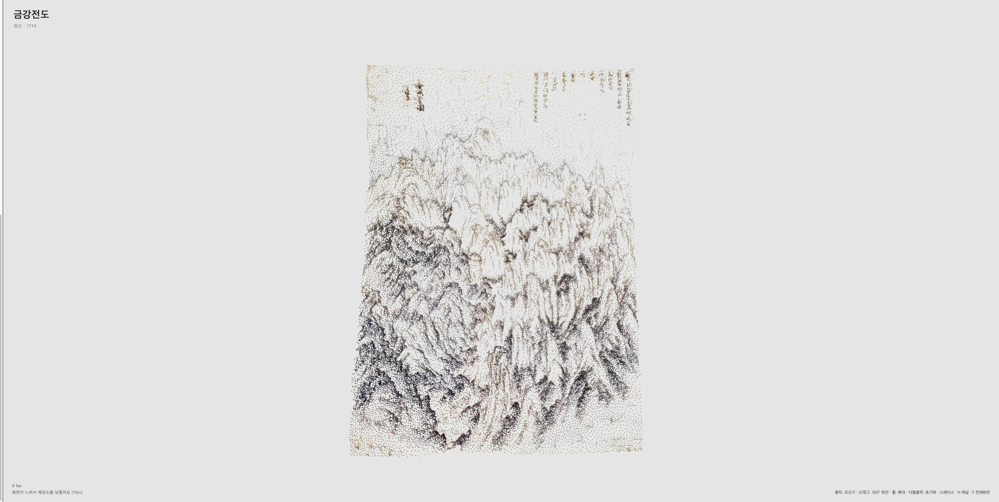

# 점묘 명화 갤러리 · Pointillism Gallery

**원작의 색·구도·여백을 존중하며, 그림 속 공간을 점으로 탐색하는 인터랙티브 갤러리.**

[PC에서 감상하기](https://devjwk.github.io/pointillism-gallery/?view=pc) · [모바일 화면](https://devjwk.github.io/pointillism-gallery/?view=mobile) · [장면의 결 · 검증 도구](https://devjwk.github.io/pointillism-gallery/tools/scene-validation/)



*공개 배포 bab816b의 금강전도 캔버스 캡처 · 2026-10-22. UI를 제외한 실제 렌더링 영역이며, 성능·지각 품질·3D 정확도의 검증 자료는 아닙니다. [이미지 기록](docs/images/README.md)*

## 어떤 프로젝트인가

흩어진 점들이 모여 작품을 이루고, 회전·확대·구성요소 탐색으로 그림을 다시 감상하는 웹 프로젝트입니다. **한국 회화를 대표 콘텐츠로 삼고, 사진 업로드를 확장 기능으로 둡니다.** 범용 3D 자산 생성 도구보다 작품의 관계와 감상 경험을 중심에 둡니다.

장기적으로는 2D 이미지를 맥락에 따라 읽고, 입체 요소는 새로운 3D 구성요소로, 나머지는 주변 환경·공간으로 해석한 뒤 점묘로 탐색하는 것을 목표로 합니다. 여백을 불필요한 물체로 채우거나 원작을 무조건 사실적인 공간으로 바꾸지 않습니다.

> **현재 구현 ≠ 장기 목표.** 현재 사진 변환은 상대 깊이로 만든 가시면의 **2.5D 기준선**입니다. 자유 회전은 뒷면 생성이 아니며, 완전한 3D 장면 생성·설정 자동 결정·부분 교정은 아직 완료하지 않았습니다.

## 지금 가능한 것

- **회화 9점 + 기존 공개 예시 사진 1점:** 작품 전환, 점의 모이기·흩어지기, 회전·확대, 작품별 해설과 구성요소 탐색.
- **원본 색 우선:** 기본 RGB·밝기 유지. 반전·보정·번짐은 선택 효과이며 점 배치·깊이와 분리됩니다.
- **같은 점으로 밀집도 조절:** 점 수를 바꾸거나 재샘플링하지 않고 원래 형태 주변의 분산을 조절합니다.
- **분리된 검증 작업대:** 가시면 메쉬·표면 샘플링·점 예산·시드·저장과 재로딩 확인. 메인 갤러리에 자동 통합된 것은 아닙니다.
- **기록된 검사:** 원본 색 변경 당시 JavaScript 109개, 통제된 WebGL 색상 48건. 단일 실사진 파일럿과 Python CLI 검사는 별도 범위입니다.

기존 작품의 의미 이름·맥락은 수동 정의입니다. 업로드 사진의 자동 의미 인식과 새 6점의 SAM 분할은 완료하지 않았습니다. 모바일용 화면은 구현했지만 실기기 성능은 미검증입니다. [현재 상태·결과·측정 한계](docs/status.md)

## 방향성과 목표 순위

아래는 앞으로의 목표이며 구현 실적이나 확정 일정이 아닙니다. **1·2순위는 사용자 제시 목표, 3·4순위는 논의를 바탕으로 정리한 후속 추천 방향**입니다.

1. **맥락 기반 2D → 새로운 3D 장면 생성**
   잠재적 입체 요소와 환경 요소를 구분하고, 완성된 객체와 주변 공간을 원작의 배치·가림 관계에 맞게 구성합니다.
2. **자연스러운 결과를 위한 설정 자동 결정**
   입력과 장면에 맞는 설정을 자동으로 선택합니다. 데이터 기반 학습은 검토 가능성일 뿐, 방식·데이터·모델은 미정입니다.
3. **원작 충실도 검증과 선택적 부분 수정**
   원본 비교, 객체별 수정·고정·되돌리기, 원본에서 참고한 영역과 새로 추정한 영역의 구분을 목표로 합니다.
4. **시점 변화에 안정적인 구조 보존형 3D 점묘 감상**
   실제 표면의 점 배치, 윤곽·형태·색의 보존, 시점·확대 변화 안정성과 실제 기기 성능을 별도로 검증합니다.

제품 경험은 **작품 선택 → 점으로 원작 등장 → 요소·맥락 탐색 → 추론한 공간 감상**을 지향합니다. 감상/실험 모드 분리는 후속 설계이며 아직 구현하지 않았습니다. 기초 평가는 1순위부터 시작하며 3순위까지 미루지 않습니다.

[제품 방향과 비목표](docs/project-direction.md) · [단계별 완료 기준](docs/roadmap.md) · [유사 서비스·연구와의 차이](docs/references.md)

## 저장소 지도

```text
index.html + src/gallery/       공개 갤러리와 22개 기능별 실행 소스
assets/artworks/                공개 작품·원본 출처·개별 지도
dist/gallery.js                 순서를 보존해 생성하는 번들
tools/scene-validation/         별도 2.5D·표면 점묘 검증 작업대
pipelines/scene_reconstruction/ GPU 연결 프로토타입 · 실제 추론 미실행
scripts/ + tests/               빌드·로컬 실행·변환·회귀 검사
docs/                           방향·로드맵·사용법·측정 기록
  results/                      익명 집계와 검증 근거
  images/                       현행 문서용 이미지
  archive/                      과거 README·소개 시안·이전 화면
```

실행 경로를 유지하며 문서와 과거 자료만 정리했습니다. 생성된 번들 대신 소스를 수정한 뒤 빌드하세요. 별도 비공개 연구는 재현 가능한 실험을 위한 작업이며, 그 데이터·실적을 이 공개 갤러리에 섞지 않습니다.

[수정할 파일 찾기](docs/architecture.md) · [문서 찾아보기](docs/README.md) · [이번 정리와 보존 범위](docs/reorganization.md)

## 로컬 실행과 검증

Node.js 20 이상, 갤러리용 외부 npm 패키지 설치는 필요 없습니다. 명령은 아래와 같습니다.

```sh
npm run build
npm test
npm run test:python:stdlib
npm run preview
# http://127.0.0.1:8790/
# http://127.0.0.1:8790/tools/scene-validation/
```

- 최초 실행에는 라이브러리·깊이 모델 다운로드가 필요할 수 있습니다. 처음부터 완전 오프라인인 것은 아닙니다.
- GitHub Pages는 GPU 백엔드를 제공하지 않습니다. GPU 연결 코드는 별도 공식 환경과 검증이 필요합니다.
- 개인 사진 외부 전송·학습·서버 구축·비용 지출은 별도 승인 없이 진행하지 않습니다.

## 한계와 권리

숨은 면은 단일 이미지에서 확인할 수 없는 생성 가설입니다. 점묘의 자연스러움, 원작 구도 정합성, 구조적 개연성, 실측 3D 정확도와 성능은 서로 다른 평가입니다. 현재의 기술 검사로 이 전체를 검증했다고 주장하지 않습니다.

회화 원본은 Wikimedia Commons 출처를 기록했으며, 기존 예시 사진은 제공자 보유 자료로 퍼블릭 도메인이 아닙니다. 개인 원본·장면·가중치·인증 정보·비공개 연구 자료는 공개하지 않습니다. 코드 라이선스는 아직 선택하지 않았습니다.

[작품과 이미지 권리](docs/artworks.md) · [모델 출처·사용 조건](docs/model-sources.md) · [원본 색 처리](docs/source-colors.md)
