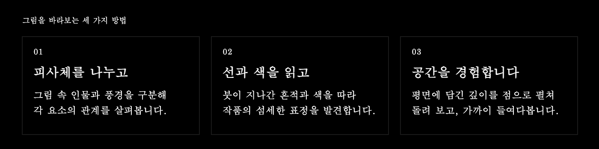
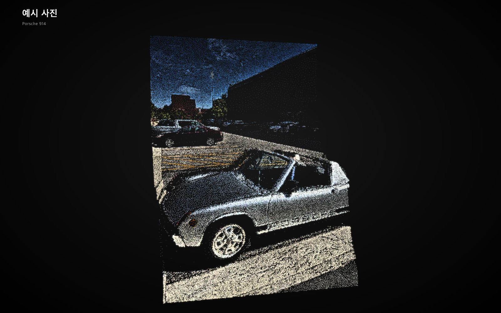
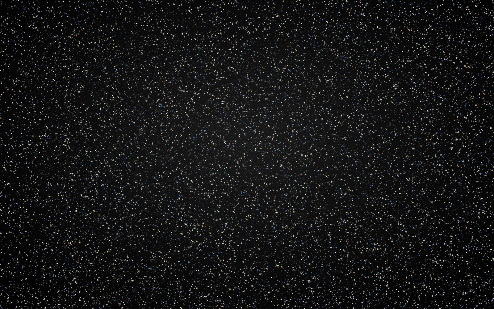
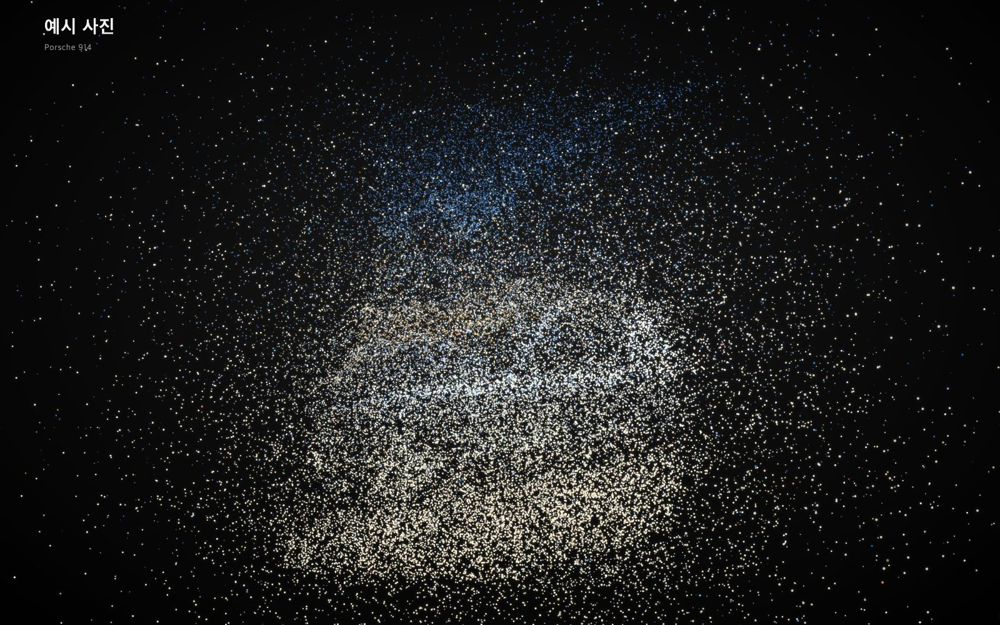
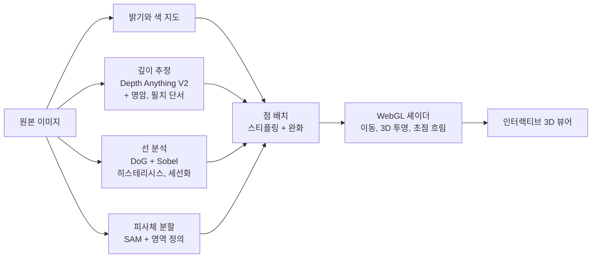
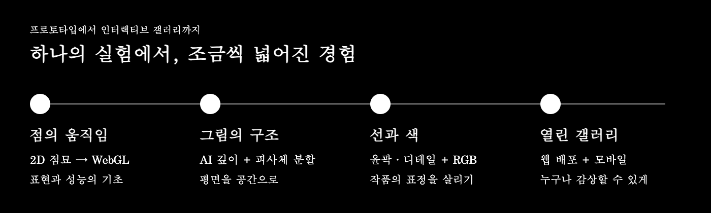
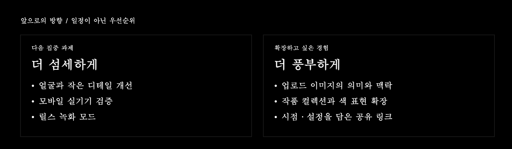

<div align="center">

<a href="https://devjwk.github.io/pointillism-gallery/"></a>

<br>

[](https://devjwk.github.io/pointillism-gallery/?view=pc)
[](https://devjwk.github.io/pointillism-gallery/?view=mobile)

**[PC 버전](https://devjwk.github.io/pointillism-gallery/?view=pc)　|　[모바일 버전](https://devjwk.github.io/pointillism-gallery/?view=mobile)**

<sub>먹과 여백에서 시작해, 점으로 이어지는 우리 그림의 새로운 풍경.</sub>

[컨셉](#컨셉) · [작품 갤러리](#갤러리) · [개발 여정](#프로젝트-진행-과정) · [앞으로의 목표](#앞으로의-목표)

</div>

<br>

## 컨셉

> **그림을 감상하는 또 하나의 방식.**
> 먹선과 여백, 색과 질감에 담긴 한국 회화의 표현을 수만 개의 점으로 다시 바라봅니다.
> 작품을 돌려 보고 가까이 들여다보며, 그 안의 피사체와 선, 공간의 깊이를 탐색하는 인터랙티브 아트 프로젝트입니다.



<details>
<summary>세 가지 관점을 구현하는 방법</summary>

| | 질문 | 지금 하는 방식 |
|---|---|---|
| **피사체** | 이 그림은 무엇으로 이루어져 있나 | AI 분할(SAM)로 조각을 나누고, 작품별로 의미 있는 구성요소(치마, 저고리, 소나무 숲 등)로 묶음 |
| **선과 세부** | 어떤 선으로, 어디를 공들여 그렸나 | 윤곽과 필치를 따로 추출해 점 밀도와 윤곽선 점에 반영, 디테일 영역은 눌러서 확대 |
| **맥락과 깊이** | 앞과 뒤는 어떻게 놓여 있나 | AI 깊이 추정에 명암, 필치 단서를 합쳐 3D로 배치하고 작품별 해설을 제공 |

</details>

<br>

## 갤러리

<details>
<summary>실제 PC 뷰어 화면 보기</summary>


</details>

<table>
  <tr>
    <td align="center" width="50%"><br><b>인왕제색도</b><br><sub>정선 · 1751 · 짙은 먹의 암벽과 옅은 먹의 안개가 앞뒤 층으로 나뉩니다</sub></td>
    <td align="center" width="50%"><br><b>씨름</b><br><sub>김홍도 · 조선 후기 · 둘러앉은 구경꾼과 씨름하는 두 사람이 서로 다른 깊이에 놓입니다</sub></td>
  </tr>
  <tr>
    <td align="center" width="50%"><br><b>미인도</b> (왼쪽) / <b>선 분석 보기</b> (오른쪽)<br><sub>신윤복 · 조선 후기 · 추출한 선만 따로 보면 옷 주름과 머리 윤곽이 드러납니다</sub></td>
    <td align="center" width="50%"><br><b>예시 사진</b><br><sub>Porsche 914 · 사진도 같은 방식으로 점묘 3D가 됩니다</sub></td>
  </tr>
</table>

### 흩어짐과 모임

점은 작품 사이에서도 그대로 유지됩니다. 같은 점들이 다른 그림으로 변형되며 이동합니다.

<table>
  <tr>
    <td align="center" width="50%"><br><sub>흩어진 상태</sub></td>
    <td align="center" width="50%"><br><sub>모이는 중</sub></td>
  </tr>
</table>

<br>

## 동작 원리



- 점의 이동, 원근 투영, 초점 흐림, 마우스 반응은 모두 GPU 셰이더에서 계산합니다. PC 테스트에서는 점 약 6만 개를 60fps로 렌더링했습니다. 실제 성능은 기기와 설정에 따라 달라집니다.
- 작품의 지도(밝기, 깊이, 색, 영역)는 압축해서 `index.html` 안에 내장했습니다. 서버가 필요 없습니다.
- 내 이미지를 불러오면 깊이와 구성요소는 **내 브라우저 안에서** 계산합니다. 이미지는 서버로 올라가지 않습니다.

<br>

## 사용법

<table>
  <tr>
    <td width="58%" valign="top">

| | PC | 모바일 |
|---|---|---|
| 작품 선택 | 왼쪽 목록 | 아래 목록 |
| 회전 | 드래그 | 한 손가락 |
| 확대 | 휠, 트랙패드 핀치 | 두 손가락 핀치 |
| 초기화 | 더블클릭, `0` | 두 번 탭 |
| 설정 | 왼쪽 패널 | `설정` 버튼 |
| 단축키 | `Space` 모이기/흩어지기<br>`L` 선 분석<br>`H` 패널 숨기기<br>`F` 전체화면<br>`N` `P` 다음/이전 작품 | |

**구성요소 칩**을 누르면 해당 피사체가 강조되고, **디테일 영역**을 누르면 그 부분으로 확대됩니다.
내 이미지는 `이미지 불러오기`로 올릴 수 있습니다.

</td>
    <td width="42%" valign="top" align="center">
      
      <br><sub>모바일: 그림이 위에, 설정은 아래 시트로</sub>
    </td>
  </tr>
</table>

### PC와 모바일 최적화

기기는 자동으로 구분합니다. 원하는 환경으로 바로 열려면 [PC 전용 링크](https://devjwk.github.io/pointillism-gallery/?view=pc) 또는 [모바일 전용 링크](https://devjwk.github.io/pointillism-gallery/?view=mobile)를 사용하세요. 모바일 링크는 휴대폰에서 열면 터치 조작과 모바일 화질 설정이 적용됩니다.

| | PC | 모바일 |
|---|---|---|
| 레이아웃 | 사이드바 + 큰 화면, 슬라이더 4묶음으로 접기 | 하단 시트 (작품, 구성요소, 조정, 도구), 가로 모드 지원 |
| 점 개수 기본값 | 45,000 (최대 80,000) | 22,000, 저사양 14,000 (최대 40,000) |
| 해상도 상한 | 2배 | 1.75배 |
| 무거운 작업 | 바로 실행 | 시작 전에 확인창 |

두 환경 모두 화면이 약 2초 이상 30fps 아래로 느려지면 해상도를 먼저, 그다음 점 개수를 자동으로 낮춥니다.

<br>

## 프로젝트 진행 과정



<details>
<summary>단계별 구현과 기술적 선택 자세히 보기</summary>

| 단계 | 한 일 | 결정과 배운 점 |
|---|---|---|
| **0. 출발** | SNS에서 본 After Effects ASCII 효과 튜토리얼을 분석하고, 이미지를 점으로 다시 그리는 연출을 웹에서 해보기로 함 | 한국 명화로 방향을 정함 (조선시대 작품은 퍼블릭 도메인) |
| **1. 2D 점묘** | Canvas2D로 점이 흩어졌다 모이는 첫 프로토타입 | 3만 점에서 5.8~18fps로 너무 느림 |
| **2. WebGL 전환** | 이동과 투영 계산을 셰이더로 옮김 | 약 6만 점에서 60fps. 셰이더 정밀도 불일치 버그도 이때 해결 |
| **3. 3D로 확장** | Depth Anything V2 (small)로 깊이 추정, 드래그 회전, 원근, 마우스 반응 | 깊이 모델은 사진으로 학습돼 그림에서는 약함 |
| **4. 그림 단서 합성** | 명암을 높이로, 필치를 부조로 바꿔 깊이에 합성. 먹선이 점 밀도에서 비는 문제는 명암 반전으로 해결 | 더 큰 모델과 타일 융합도 시도했지만 개선이 없고 6분이 걸려 채택하지 않음 |
| **5. 피사체 분할** | SAM으로 조각을 나누고 구성요소 칩, 클릭 선택, 층 분리 슬라이더 추가 | 자동 이름 붙이기(CLIP, DETR)는 신뢰도가 낮아 실패. 내장 작품은 직접 영역을 정의하고 SAM 경계에 맞춤 |
| **6. 선과 디테일** | 선 분석(DoG, Sobel, 세선화), 윤곽선 점, 디테일 영역 확대, 고해상도 밝기 지도(900px) | 윤곽 점과 지역 대비로 이목구비 식별은 가능해졌지만 사진 수준은 아님 |
| **7. 색 (RGB)** | 원본 색을 점에 입히고, 비단의 누런 기운을 빼는 색 보정 추가 | 보정이 없으면 미인도가 전부 금빛 단색으로 보임 |
| **8. 배포** | GitHub Pages로 누구나 열 수 있게 공개 | 파일 하나(약 1.9MB)로 충분 |
| **9. PC와 모바일 분리** | 하단 시트, 터치 조작, 기기별 점 개수와 해상도, 자동 화질 조절 | 실기기 검증은 아직 남음 |

</details>

<details>
<summary>현재 수치 · PC 테스트 환경에서 측정한 참고값</summary>

| 항목 | 값 |
|---|---|
| 내장 작품 | 4점 (회화 3, 사진 1) |
| PC 점 개수 | 기본 45,000 (보간 점과 윤곽선 점 포함 약 6만 개 렌더링) |
| 프레임 | 60fps (PC, 6만 점 이상) |
| 작품 첫 분석 시간 | PC 약 0.5~2초 |
| 내 이미지 구성요소 분석 | PC 약 80~90초 |
| 파일 크기 | 약 1.9MB |

</details>

<br>

## 앞으로의 목표



> 일정이 확정된 계획이 아니라 우선순위 순서의 방향입니다.

**완료**

- [x] 점이 흩어졌다 모이는 3D 점묘 뷰어 (WebGL)
- [x] AI 깊이 추정 + 그림 단서 합성
- [x] 피사체 분할, 구성요소 칩, 작품별 맥락 해설
- [x] 선 분석, 윤곽선 점, 디테일 영역 확대
- [x] RGB 색, 색 보정, 색수차
- [x] 내 이미지 불러오기
- [x] GitHub Pages 공개
- [x] PC와 모바일 분리 최적화

**다음**

- [ ] **얼굴과 세부 디테일 개선**: 얼굴 파싱 모델(눈, 코, 입, 머리)을 사진에서 먼저 검증한 뒤 그림에 적용. 더 높은 해상도의 원본 확보 (미인도 원본은 가로 400px라 한계가 있음)
- [ ] **모바일 실기기 검증**: 기기별 fps, 첫 분석 시간 측정과 튜닝
- [ ] **릴스 녹화 모드**: 9:16 화면, 자동 카메라 시퀀스, webm 저장

**그다음**

- [ ] 내 이미지의 **의미 자동 인식**과 맥락 생성 (이미지를 해석하는 외부 모델이 필요한지 검토)
- [ ] 가려진 면(뒷면) 복원 (인페인팅)
- [ ] 작품 추가: 퍼블릭 도메인 조선 회화 위주, 근현대 작가는 저작권 보호 기간 확인 후
- [ ] 윤곽선 점 강조색, 피사체별 색 조절
- [ ] 모바일 두 손가락 이동, 기울여 보기(자이로)
- [ ] 현재 시점과 설정을 담은 공유 링크
- [ ] 코드 라이선스 결정

<br>

## 알려진 한계

- 얼굴 같은 세부는 **원본 해상도**에 좌우됩니다. 미인도 원본은 가로 400px라 이목구비를 사진처럼 복원하지 못합니다.
- 깊이 모델은 사진 학습 기반이라 그림에서는 약합니다. 그래서 명암과 필치 단서를 보조로 합성합니다.
- 내가 올린 이미지는 구성요소 이름을 자동으로 붙이지 못합니다. "피사체 N"으로 표시되고, 더블클릭으로 이름을 바꿀 수 있습니다. 맥락 해설은 내장 작품에만 있습니다.
- 가려진 면(뒷면)은 복원하지 않습니다.
- 모바일 실기기에서는 아직 충분히 검증하지 못했습니다. 모바일에서 구성요소 분석(SAM)은 1~3분 걸리고 메모리를 많이 씁니다.

<br>

## 기술 구성

- 빌드 도구 없는 단일 HTML 파일 (바닐라 JavaScript + WebGL)
- 선 분석: 다중 스케일 DoG + Sobel, 히스테리시스, Zhang-Suen 세선화
- 점 배치: 밝기 기반 스티플링 + 완화(relaxation), 깊이 차가 큰 곳은 보간 점으로 빈틈 채움
- 깊이 추정: [Depth Anything V2 (small)](https://huggingface.co/onnx-community/depth-anything-v2-small)
- 구성요소 분석: [SlimSAM](https://huggingface.co/Xenova/slimsam-77-uniform)
- 모델 실행: [transformers.js](https://github.com/huggingface/transformers.js) (브라우저). 내 이미지를 올릴 때만 필요하고, 모델은 처음에 인터넷에서 내려받습니다.

### 로컬에서 실행

```bash
python3 -m http.server 8000
# http://localhost:8000/ 접속
```

### 수정과 배포

GitHub Pages가 `main` 브랜치의 `index.html`을 그대로 게시합니다. 파일을 교체해서 커밋하면 1~2분 안에 반영됩니다.

<br>

## 이미지 출처와 저작권

- 인왕제색도, 미인도, 씨름: Wikimedia Commons의 퍼블릭 도메인 이미지입니다.
- 예시 사진: 프로젝트 소유자가 제공한 사진입니다. 회화 이미지와 동일한 퍼블릭 도메인으로 취급하지 않습니다.
- 이 저장소에는 아직 별도 라이선스 파일이 없습니다. 코드를 재사용하려면 먼저 문의해 주세요.
