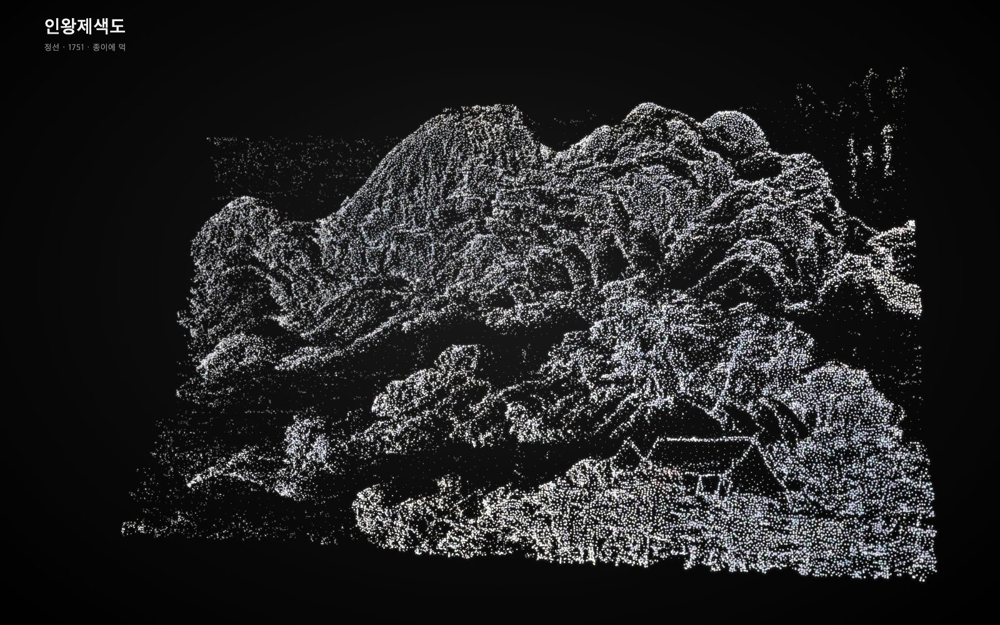
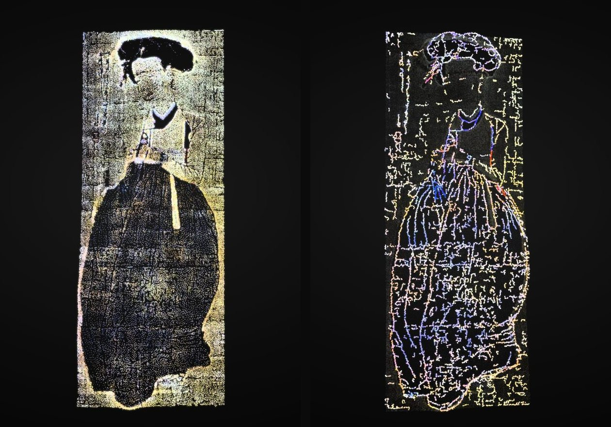
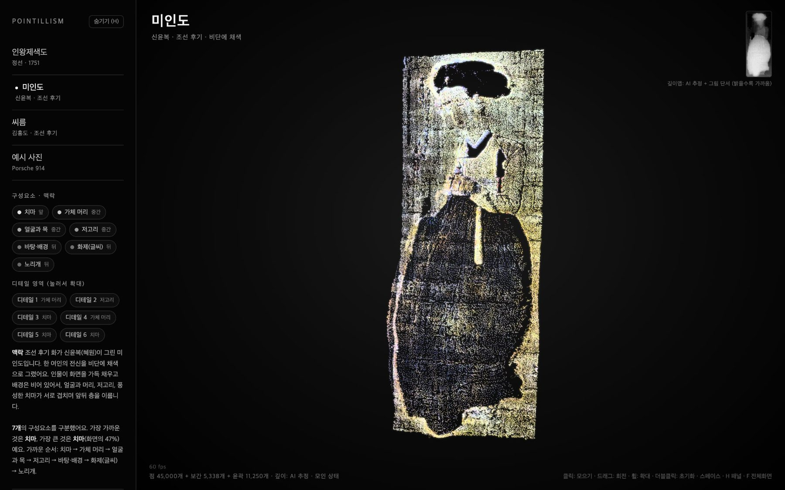
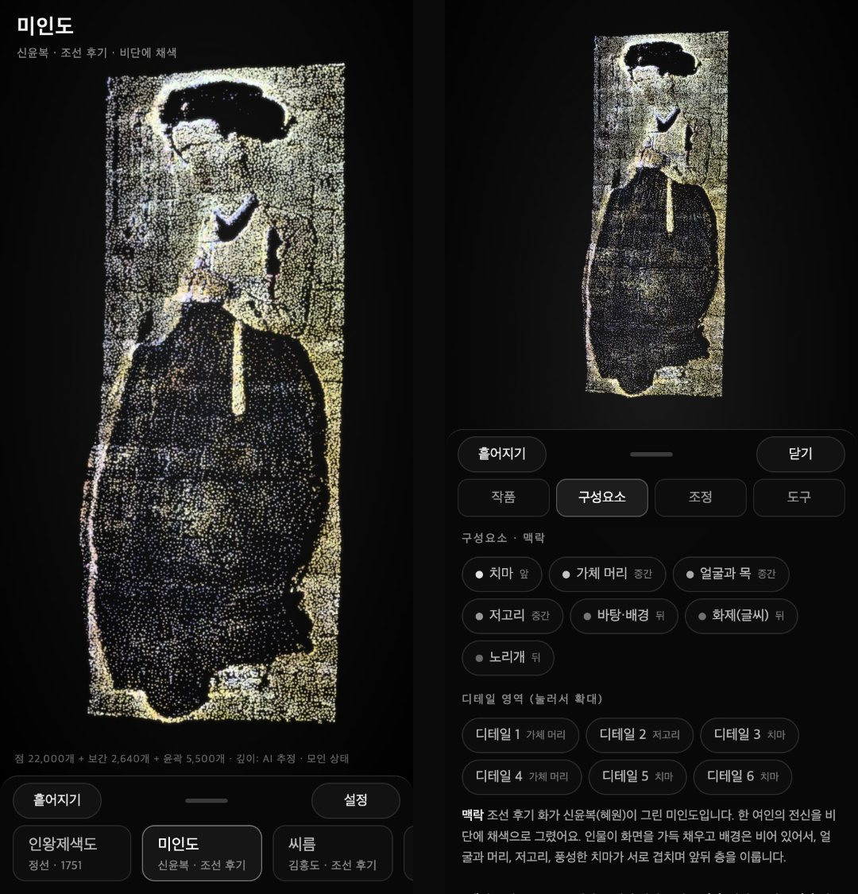

# 현재 구현과 검증 기록

**기능 근거: 공개 커밋 bab816b까지.** 내장 작품은 10점이며, 원본 색 변경 당시 JavaScript 109개와 통제된 WebGL 색상 검사 48건이 통과했습니다. 수치는 각 기록의 조건에서만 해석합니다. 새 목표는 [로드맵](roadmap.md)에 있으며 완료 기능과 구분합니다.

- **공개 배포 · 메인 갤러리** 
  **회화 9점·기존 공개 예시 사진 1점, 총 10점.** 금강전도·서당·무동·단오풍정·월하정인·세한도를 추가했습니다. 새 6점은 작품 선택 시 이미지 지도를 개별 로딩하며 출처 링크와 수동 해설을 제공합니다. **기본 표시는 원본 RGB와 밝기를 유지**하며 색 반전·강한 보정·번짐은 선택 효과입니다. [원본 색 수정·검증](source-colors.md) WebGL 점 렌더링, 작품 전환, 상하좌우 360° 회전·확대, 점 밀집도, RGB·색 보정, PC·모바일용 설정을 제공합니다. 선·디테일 분석, SlimSAM 분할과 피사체 선택도 구현했습니다. 기존 작품의 의미 이름·맥락은 수동 정의이며 업로드 사진의 자동 의미 인식은 아닙니다. **새 6점의 SAM 분할은 아직 실행하지 않았습니다.** [작품·권리·지도 구성](artworks.md)
- **실행 확인 · 가시면 메쉬와 표면 점묘** 
  브라우저 로컬 상대 깊이 추정과 삼각형 표면 생성으로 실사진 기술 파일럿 1건을 기록했습니다. 고정 시드·정확한 총 점 예산, 회전 시 점 유지와 저장 파일 재로딩을 확인했습니다. 다수 사진의 지각 품질은 별도 검증이 필요합니다.
- **분리 완료 · 기능별 코드** 
  갤러리 22개 기능별 소스, 독립 검증 도구, 일회성 GPU 경로, 문서·테스트·개발 스크립트로 구분했습니다.
- **코드 준비 · 뒷면과 가려진 배경 생성** 
  SAM3D·SAM2·LaMa 연결 프로토타입입니다. 실제 GPU 추론, 모델 환경과 생성 품질은 미검증입니다.
- **미완료 · 메인 사이트 자동 통합** 
  검증된 변환·점 배치 기능부터 연결할 예정입니다. 사진별 자동 맞춤, 업로드 사진의 자동 의미·맥락 생성과 전체 3D 생성 흐름은 아직 완료하지 않았습니다.

메인 갤러리는 **감상 공간**, [장면의 결](../tools/scene-validation/README.md)은 **알고리즘을 확인하는 작업대**입니다. 검증 도구가 추가됐다고 새 변환 알고리즘이 메인 갤러리에 자동 적용된 것은 아닙니다.

 

## 실제 결과

### 1. 기존 갤러리의 표현 · 이전 스냅샷

아래 화면은 원본 색 기본값 수정 전의 공개 뷰어 스냅샷입니다. 현재 기본값은 [원본 RGB 표시](source-colors.md)이며 이전 발광 표현과 다릅니다. 아래 이미지는 **깊이와 점으로 표현한 감상 예시**이며, 실측 3D 복원 정확도를 보여주는 자료는 아닙니다.

<table>
  <tr>
    <td align="center" width="50%"> <b>인왕제색도</b> 정선 · 먹의 농담과 앞뒤 층</td>
    <td align="center" width="50%"> <b>씨름</b> 김홍도 · 인물과 배경의 깊이</td>
  </tr>
  <tr>
    <td align="center" width="50%"> <b>미인도 · 선 분석</b> 신윤복 · 색과 윤곽, 옷의 주름</td>
    <td align="center" width="50%"> <b>장면의 결 · 합성 검사</b> 구와 평면으로 확인한 렌더러. 실사진 생성 결과 아님</td>
  </tr>
</table>

전체 PC 화면과 모바일 UI 보기

모바일용 레이아웃·터치 조작은 구현되어 있지만, 실기기별 성능 검증이 완료됐다는 뜻은 아닙니다.

### 2. 실사진 1장으로 기록한 가시면 기술 파일럿

**2026-10-21 기록 · 입력 1장 · 샘플링 시드 42 · 상대 깊이 기반 · GPU 장면 생성 미실행**

| 항목 | 실제 기록 |
|---|---|
| 정점 | **49,152개** |
| 삼각형 | **96,277개** · 경계에서 제외한 1,133개는 미포함 |
| 점 수 | **4,000 / 8,000 / 16,000개** · 각 예산과 실제 수 일치 |
| 회전 | **+30° / −30° / 180°**에서 같은 점 버퍼 유지 |
| 재로딩 | 저장 파일을 다시 열어 **동일 점 지문 확인** |
| 업로드 | 해당 로컬 변환 버튼 검사에서 **요청 0건 관측** |

180° 보기는 복원된 뒷면이 아닙니다. 최초 라이브러리·모델 다운로드는 필요하며, 0건 관측은 모든 실행 환경의 네트워크 감사 인증을 뜻하지 않습니다.

개인 사진의 원본·변환 이미지·장면 파일·식별 정보는 공개하지 않고 **수치만 익명화**했습니다. 따라서 이 사진에 대한 수치를 제3자가 동일 입력으로 재현할 수 있는 공개 데이터셋은 제공하지 않습니다.

같은 메쉬·8,000점·시드 42에서, 원본 시점 투영 가중 방식의 픽셀 차이가 면적 균일 방식보다 작게 기록됐습니다. **단일 사진·단일 시드 관측값으로, 알고리즘의 일반적 우수성이나 3D 정확도를 입증하지 않습니다.**

점 예산별 실제 수치와 측정 조건

참조 시점의 같은 영역을 **192×256 sRGB**로 비교했습니다. MAE는 채널별 평균 절대 차이, RMSE는 평균 제곱 차이의 제곱근입니다. 범위는 채널값 기준 0~255이며, 낮을수록 해당 원본 픽셀에 가깝습니다.

면적 = 표면 면적 균일, 참조 = 원본 시점 투영 가중. 지름은 CSS px입니다.

| 방식 | 점 수 | 지름 | MAE | RMSE |
|---|---:|---:|---:|---:|
| 면적 | 8,000 | 7.02 | 62.19 | 93.06 |
| 참조 | 4,000 | 9.93 | 45.10 | 74.72 |
| 참조 | 8,000 | 7.02 | 43.41 | 72.54 |
| 참조 | 16,000 | 4.96 | 42.62 | 71.24 |

연속 메쉬 표면 참고값은 **MAE 11.39 / RMSE 24.35**입니다.

- 점 수가 바뀌면 화면 점 크기 보정도 함께 바뀝니다. 따라서 예산별 차이를 **점 수 하나만의 효과**로 해석할 수 없습니다.
- 픽셀 차이는 점의 크기·빈틈·배경·렌더링 방식에도 영향을 받습니다. 지각 품질 점수, 피사체 인식률, 실측 깊이 오차가 아닙니다.
- 연속 표면과 이산 점묘는 표현 방식이 다르므로, 메쉬 참고값으로 점묘 알고리즘의 우열을 판정하지 않습니다.
- 카메라 FOV와 깊이 스케일은 가정값입니다. 카메라 구성의 산술적 재투영 일관성도 실제 형상 정확도의 증거는 아닙니다.

[익명화한 원시 집계값](results/visible-surface-pilot.json) · [측정 방법·공개 범위](results/README.md)

### 3. 코드와 실행 흐름 검증

**원본 색 기본 표시:** 원본 RGB/밝기와 점 배치 중요도를 분리하고 초기 색 반전·WB·과한 채도·번짐을 해제했습니다. JavaScript **109개 통과**, 합성 12색의 실제 WebGL 48건에서 불투명 점 중심의 RGB 바이트 최대 오차 0을 확인했습니다. 전체 이미지의 픽셀 동일성이나 지각 품질 점수가 아닙니다. [수정·조건·검증](source-colors.md)

**조선 회화 6점 추가:** 출처·공개 도메인 표시·원본 해시를 기록하고, 실제 브라우저 로컬 상대 깊이 추정과 작품별 개별 지도 로딩을 연결했습니다. 데이터·로더·해설 안전성 검사를 포함해 추가 당시 JavaScript **64개가 통과**했습니다. 새 6점의 분할·숨은 면 생성·실측 3D 검증은 완료한 것으로 표시하지 않습니다. [데이터·검증 기록](artworks.md)

**후속 변경 · 점 밀집도:** 점 수와 별개로 원래 형태 주변의 흩어짐을 조절합니다. 100%는 기존 배치, 낮은 값은 같은 점의 국소 분산입니다. 밀집도 변경 당시 JavaScript **43개가 통과**했습니다. [사용·검증 안내](density.md)

**360° 자유 회전:** 기본 회전 상한을 없애고 드래그·방향키·관성에 적용했습니다. 회전 변경 당시 JS 35개가 통과했으며 제한 모드는 선택해서 사용할 수 있습니다. [변경·검증 안내](rotation.md)

아래 29개·10개 수치는 이전 구조 분리 시점의 검사 기록입니다. 최신 전체 JavaScript 기록과 합산하지 않습니다.

- **JavaScript 29개 통과:** 갤러리 소스·DOM 연결, 삼각형 샘플링, 가시면 기하, 로컬 파일 안전성, 시드·점 예산, GitHub Pages 하위 경로.
- **Python CLI 10개 통과:** 인자와 범위, 독립 시드, 덮어쓰기 거부, 실패 시 정직한 상태 기록 등 표준 라이브러리 검사.
- **분리 전후 실행 코드 일치:** 기존 공개 버전의 데이터·실행 코드를 22개 기능 소스와 번들로 옮길 때 바이트 단위 동일성을 확인했습니다.
- **배포 동작 확인:** 메인 갤러리 4개 작품 로딩, PC·모바일용 설정 링크, 검증 도구의 합성 60,000점 렌더링을 확인했습니다. 합성 검사는 사진 생성 품질 검증이 아닙니다.

**별도 미검증:** NumPy 의존 CPU 기하 테스트 9개, 전체 GPU 모델 연동, 실측 3D 정확도, 다수 이미지의 지각 품질, 모바일 실기기 성능. 과거 개발 환경의 FPS는 표준 성능 결과로 사용하지 않습니다.

[실행 검증 기록](results/verification-summary.json) · [기존 소스 분리 기록](gallery-migration.json)

 
